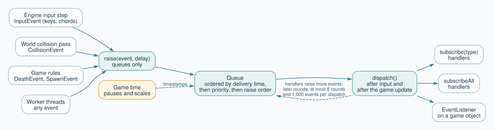

# Shared Engine, Milestone 4: Event Management

**Team:** Harsha Vardhan Puvvadi, Seojin Kim, Vanaja Agarwal · **CSC 581**  
**Github Link:** https://github.com/CSC581/shared-engine/tree/milestone-4

This is our C++17 game engine. It uses SDL3 for the window, input and drawing, and ZeroMQ for networking. Each game keeps its own rules, and any networking goes through the engine. There are tests for each module. This README only covers Milestone 4. The object model, networking and network formats were done in Milestone 3 and are described in the [Milestone 3 README](https://github.com/CSC581/shared-engine/tree/milestone-3).

```bash
git submodule update --init --recursive
cmake -S . -B build && cmake --build build -j 4 -- -k   # -k: keep going past the unported golf game
ctest --test-dir build --output-on-failure -E 'multiplayer-tests'
```

## What each part asked for and how we did it

| Part | Milestone Requirements | What we built |
| ---- | ---------------------- | ------------- |
| 1.1 | An event manager that queues events with priorities, uses the `Timeline` for timestamps, and handles collision, death, spawn and input events instead of SDL events | An `EventManager` owned by the engine. Raising an event only queues it; the engine hands out queued events twice per frame, ordered by game-time delivery, then priority, then raise order. The engine raises `InputEvent` (keys and chords) and `World` raises `CollisionEvent`; games raise `DeathEvent` and `SpawnEvent` |
| 1.2 | Events shared across the network, with event data serialized in a protocol of our choice | `EventCodec` turns a list of events into our multipart **text** network format and back. Events are text-only: Milestone 3's binary transport remains for its benchmarks, carries no events, and refuses them with an error. Events ride on the position updates clients already send. The server numbers each event, adds the sender's id and passes it to every other player exactly once, in the same order everywhere. A game picks which event types to share with `NetworkEventBridge`. Client-server mode only |
| 1.3 | A replay system that records and plays back game play, started and controlled through the event system | `ReplaySystem` records every frame's objects, the camera, an optional game-state string and every event. Six replay events start and stop recording, start and stop playback, change the speed (0.5x, 1x, 2x or any other) and pause it. Playback shows the recording in a separate world while the live game waits, paused, and then carries on where it was |

## Files for this milestone

```text
1.1 Event management
├── include/Event.hpp                                               the Event type, priorities, engine event names
├── include/EventManager.hpp                src/EventManager.cpp    queue, registration and dispatch
├── include/Components.hpp                  src/Components.cpp      EventListener component
├── include/Input.hpp                       src/Input.cpp           key and chord events
├── include/World.hpp                       src/World.cpp           collision events
├── include/Engine.hpp                      src/Engine.cpp          engine.events(), two dispatches per frame
└── sandbox/EventsDemo.cpp                                          events-demo
1.2 Networked events
├── include/EventCodec.hpp                  src/EventCodec.cpp      events in the text format
├── include/WireFormat.hpp                                          exact decimal text, event limits
├── include/NetworkProtocol.hpp             src/NetworkProtocol.cpp events in requests and replies (text)
├── include/BinaryNetworkProtocol.hpp       src/BinaryNetworkProtocol.cpp   Milestone 3 binary, no events
├── include/NetworkServer.hpp               src/NetworkServer.cpp   numbering, relaying, outboxes
├── include/NetworkClient.hpp               src/NetworkClient.cpp   pending events, resends, acknowledgements
├── include/Multiplayer.hpp                 src/Multiplayer.cpp     Session::publishEvent / takeRemoteEvents
├── include/NetworkEventBridge.hpp          src/NetworkEventBridge.cpp      shared types <-> EventManager
└── sandbox/MultiplayerDemo.cpp                                     Space pings every window
1.3 Replay
├── include/Event.hpp                                               the six replay event names
├── include/ReplaySystem.hpp                src/ReplaySystem.cpp    recording, playback, replay world
└── sandbox/ReplayDemo.cpp                                          replay-demo
```

## API reference

### Events (`Event.hpp`, `EventManager.hpp`)

| Function | Meaning |
| -------- | ------- |
| `Event{type}.set(name, value)` | Builds an event. A value is a bool, integer, decimal or text. `get<T>(name)`, `getOr<T>(name, fallback)` and `has(name)` read it back |
| `event.priority` | `EventPriority::High` (-100), `Normal` (0, the default) or `Low` (100). Lower runs first among events due at the same time |
| `engine.events()` | The game's event manager. Its timestamps come from game time |
| `events.subscribe(type, handler)` | Calls `handler` for every event of that type. Returns an id |
| `events.subscribeAll(handler)` | Calls `handler` for every event, after the type's own handlers |
| `events.unsubscribe(id)` | Stops a handler, even in the middle of a dispatch |
| `events.raise(event, delay)` | Queues an event. `delay` is in game time (default 0), so it waits while the game is paused. Safe from any thread |
| `events.dispatch()` | Hands out every due event. The engine calls it after input and after the game update |
| `object.add<EventListener>(events).listen(type, handler)` | A handler that belongs to a game object. It is skipped while the object is switched off and removed when the object is destroyed |

Subscribing, unsubscribing and dispatching happen on the main thread. A game whose handlers capture the game itself must unsubscribe them in its destructor, because `engine.events()` outlives the game.

### The four required events

| Event | Raised by | Values |
| ----- | --------- | ------ |
| `InputEvent` | The engine, when a key changes | `kind = "key"`, `key` (scancode), `state` (`"pressed"` or `"released"`) |
| `InputEvent` (chord) | The engine, after `engine.registerChord(name, keys)`, when all the keys are held and again when one is let go | `kind = "chord"`, `name`, `state` |
| `CollisionEvent` | `World`, after `world.setEventManager(&engine.events())` | `a`, `b` (object ids, smaller first), `tagA`, `tagB`, `phase` (`"enter"`, `"stay"` or `"exit"`), `trigger`. `"stay"` only fires if one of the colliders sets `raiseStayEvents = true` |
| `DeathEvent` | The game | `object`, `cause` |
| `SpawnEvent` | The game | Respawn: `object`, `x`, `y`. Create: `kind`, `x`, `y`, and optionally `request`; the creator answers with `SpawnedEvent{request, object}` |

The input polling and collider callbacks from Milestone 3 still work alongside the events.

### Event encoding (`EventCodec.hpp`)

| Function | Meaning |
| -------- | ------- |
| `appendEventsText(message, events)` | Adds a list of events to a message being built. Throws if an event breaks a rule |
| `readEventsText(message, cursor, events, error)` | Reads a list starting at `cursor`. On failure, returns false and changes nothing |
| `validateEvent(event, error)` | Checks an event against the rules below |

`OutgoingEvent` (client to server) is numbered 1, 2, 3… by the client and carries no sender id. `RelayedEvent` (server to client) is numbered by the server and carries the sender's id. An encoded event carries its type, values, priority and the sender's timestamp.

| Rule | Limit |
| ---- | ----- |
| Events per message | 64 |
| Values per event | 16 |
| Type and value names | 1 to 64 characters: letters, digits, `.`, `_` and `-` |
| Text values | 512 bytes |
| Decimals | Must be finite. Extremely small ones (below 2.2e-308) are sent as 0 |

### Sharing events over the network (`NetworkEventBridge.hpp`)

| Function | Meaning |
| -------- | ------- |
| `NetworkEventBridge(engine.events(), session, {"DeathEvent", ...})` | Shares the listed event types. Local events of those types are sent to every other player; events of other types never leave or enter. Throws in peer-to-peer mode |
| `bridge.apply()` | Raises the events other players sent. Call once a frame after `session.update()` |
| `session.publishEvent(event)`, `session.takeRemoteEvents()` | What the bridge uses underneath, for a game that wants to do it by hand. `takeRemoteEvents()` returns the events from the latest `update()`; ones not taken by the next `update()` are dropped |

A remote event has `origin` set to the sender's player id and is raised with this machine's game time; the sender's time is kept as the value `sentAt`. The sender handles its own event locally at once and never gets it back.

| Rule | Value |
| ---- | ----- |
| Delivery | Exactly once, in the server's order. Lost requests and replies are resent, and repeats are dropped by number |
| Events per request or reply | 64; more wait for the next one |
| Events waiting at the server for one player | 256 (`ServerConfig::eventOutboxLimit`); a player further behind loses its oldest |
| Events waiting at a client | 256 each way; a full queue drops its oldest unsent (or untaken) event |
| Leaving | `leave()` sends events published just before it, waiting at most about 0.2 s |

### Replay (`ReplaySystem.hpp`)

| Function | Meaning |
| -------- | ------- |
| `ReplaySystem replay(engine.events(), engine.gameTime(), engine.realTime())` | Listens for the replay events on the game's event manager |
| `replay.capture(world, cameraX, cameraY)` | Call every frame after the world updates. Records a frame while recording and does nothing otherwise |
| `replay.update()` | Call every frame, also while paused. Moves the playback along |
| `replay.isPlaying()`, `replay.world()`, `replay.cameraX()`, `replay.cameraY()` | While playing, draw `replay.world()` with `renderWorld()` at the replay's camera instead of the live world |
| `replay.setFrameStateHook(fn)`, `replay.currentFrameState()` | Records a string each frame, such as the score, and gives it back during playback for the HUD |
| `replay.events()` | A separate event manager on which the recorded events happen again during playback, for visual effects only |
| `replay.setRollingWindow(tics)` | Keeps only the last stretch of recording, for a "kill cam" after a death |

| Event | Values | Effect |
| ----- | ------ | ------ |
| `ReplayRecordStartEvent` | | Starts a new recording |
| `ReplayRecordStopEvent` | | Stops recording and keeps it |
| `ReplayPlayStartEvent` | `speed` (optional) | Pauses the live game and plays the recording from the start |
| `ReplayPlayStopEvent` | | Ends playback. Also raised by the replay itself when the recording ends |
| `ReplaySpeedEvent` | `speed` | Changes the playback speed, now and for the next playback |
| `ReplayPauseEvent` | `paused` (optional) | Pauses or resumes playback. Without `paused` it toggles |

A game raises these from whatever it likes, such as a key's `InputEvent` or a `DeathEvent`. While playing, the game should skip its own update. Replay records texture pointers, not copies, so a game must keep its textures alive while a recording that uses them may be played.

## Design decisions

- **Raising only queues.** Handlers never run inside a collision pass or a loop over objects, so a handler can safely create or destroy objects.
- **Events are a name plus values,** not a class per event, so a game adds a new event type without changing the engine, and every event can be sent over the network the same way.
- **Chains finish in one frame, but cannot run forever.** Events raised by handlers are handled in later rounds of the same dispatch, up to 8 rounds and 1,000 events.
- **Timestamps use game time,** so a delayed event, like a respawn, waits while the game is paused.
- **The server decides who sent an event.** Clients never send their own id, so they cannot fake another player's events.
- **Each client detects, the server orders.** A client raises its own collisions and deaths locally without waiting; the server gives shared events one order and relays them, without reading them.
- **Events ride on position updates.** No new messages or round trips. With send pacing, a client with events waiting resends its last position so they go at once.
- **Only listed types cross the network,** in both directions, so another player cannot raise an `InputEvent` on your machine.
- **Replay shows what was recorded and does not simulate again.** Frame times vary, so running the inputs through physics again would not give the same result. Positions and the camera are blended between frames, so slow motion is smooth.
- **Playback never touches the live game.** It uses its own world, its own event manager and its own timeline on real time. The live game is paused underneath and is left paused afterwards if the player had paused it.

**Known limitations:** event values are only checked when the program runs, so the sender and receiver must agree on value names. Handlers do not return results; a handler that needs to answer raises another event. A client the server timed out (3 s without a message) misses events relayed while it was gone, and in rare cases one of its own events can be relayed twice. Players who join later do not get earlier events. Peer-to-peer mode carries no events. Replay is local to one machine, and a networked game resumes against the current network state. Replay follows game time, so time the game spent paused while recording is skipped, and a stretch recorded with the game at 2x plays at half its original pace at replay speed 1. Recording keeps everything until it stops, unless a rolling window is set.

<div style="page-break-before: always"></div>

## Appendix: how the pieces fit

**A. One event, from raise to handler (1.1).** Engine systems, game rules and worker threads raise events, which only puts them in the queue with a game-time timestamp. Twice per frame, `dispatch()` hands out every due event, in order, to the handlers registered for its type and then to the `subscribeAll` handlers. Events raised by those handlers run in later rounds of the same dispatch.



<sub> **Disclaimer:** The team designed and wrote code, but also used LLMs such as Claude Sonnet 5 and ChatGPT 5.6 Terra to help restructure the code and refactor the components when in need.</sub>
